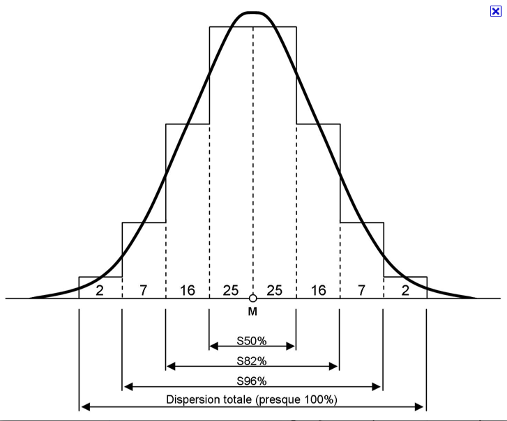

> En biostatistique, quand on parle de vérifier la normalité et l’homoscédasticité, c’est souvent avant de choisir un test statistique. L’objectif est de savoir si on peut utiliser des tests paramétriques (comme le t-test ou l’ANOVA) ou s’il faut passer à des tests non paramétriques.

On procède donc en deux vérifications distinctes.

- la variable quantitative suit une distribution normale dans chaque groupe (Normalité)
- les variances des groupes sont égales (homoscédasticité)

### 1. Vérifier la normalité

La normalité concerne la distribution de la variable quantitative dans chaque groupe étudié.

Par exemple : on mesure la glycémie dans deux groupes de patients (traitement vs contrôle). Avant de comparer les moyennes, on regarde si les données suivent une distribution normale.

#### 1.1 Approche est visuelle
- ***Un histogramme*** permet de voir si la distribution ressemble à une courbe en cloche (gausienne).

- ***Un QQ-plot*** est encore plus utilisé en biostatistique. On compare les quantiles des données à ceux d’une distribution normale. Si les points suivent la ligne diagonale, la distribution est proche de la normale.

#### 1.2 Approche par test statistique de normalité
Le plus courant est le test de **Shapiro-Wilk**.

Hypothèses :
- H0 : les données suivent une distribution normale
- H1 : les données ne suivent pas une distribution normale

Interprétation :
- p-value > 0.05 → normalité acceptable
- p-value < 0.05 → distribution non normale

D’autres tests existent :
- Kolmogorov-Smirnov
- Anderson-Darling

Mais **Shapiro-Wilk** est souvent recommandé pour les petits échantillons.

### 2. Vérifier l’homoscédasticité

> L’homoscédasticité signifie que la variance est la même entre les groupes.

Exemple : comparer la tension artérielle entre trois traitements.
Les variances des groupes doivent être similaires pour utiliser une ANOVA classique.

Pour vérifier cela, on utilise des tests d’égalité des variances.

Le plus classique est le **test de Levene**.

Hypothèses :

- H0 : les variances sont égales
- H1 : les variances sont différentes

Interprétation :

- p-value > 0.05 → variances homogènes
- p-value < 0.05 → variances différentes

Un autre test utilisé est le **test de Bartlett**, mais il est très sensible à la non-normalité. C’est pour cela que **Levene** est souvent préféré en biostatistique.

### 3. Exemple typique en biostatistique

Supposons qu’on compare la pression artérielle entre trois groupes de traitement.

Étapes :

1. Vérifier la normalité dans chaque groupe (Shapiro-Wilk)
2. Vérifier l’égalité des variances entre les groupes (Levene)
3. Choisir le test de comparaison

Si les deux conditions sont respectées :
**→ ANOVA**

Si la normalité n’est pas respectée :
**→ Kruskal-Wallis**

Si les variances sont différentes :
**→ Welch ANOVA**

### 4. Résumé rapide

Normalité → Shapiro-Wilk
Homoscédasticité → Levene

Ces deux vérifications servent surtout à décider si on peut appliquer des tests paramétriques comme :

- t-test
- ANOVA
- régression linéaire

Sinon on utilise des tests non paramétriques.

> Il y a aussi une petite subtilité intéressante en biostatistique : quand la taille d’échantillon devient grande (souvent > 30), le théorème central limite fait que beaucoup de tests paramétriques restent robustes même si la normalité n’est pas parfaite. La statistique tolère alors quelques imperfections… un peu comme un microscope qui reste utile même si la lentille n’est pas absolument parfaite.